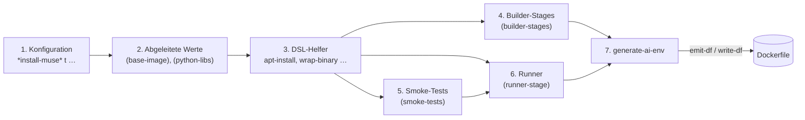
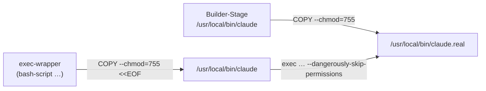

# Walkthrough: Refactoring von `gen_ai_env.lisp`

Dieses Dokument beschreibt, was beim Refactoring des Dockerfile-Generators
`source01/examples/03_ai_env/gen_ai_env.lisp` am 19. November 2026 tatsächlich
gemacht wurde, welche Fehler dabei ans Licht kamen und wie man den Generator jetzt
erweitert. Grundlage waren `review.md` (Befunde F1–F12, D1–D8) und `task.md` in
diesem Ordner. Alle Arbeiten liegen auf dem Branch `refactor/ai-env-generator`.

## Kurz zur Erinnerung: wie der Generator funktioniert

`gen_ai_env.lisp` schreibt kein Dockerfile von Hand. Es baut eine Liste von
**S-Expressions** (verschachtelte Lisp-Listen wie `(run "apt-get update")`), und die
Bibliothek `cl-dockerfile-generator` (`source01/dock.lisp`) übersetzt diese Liste in
Dockerfile-Text. Zwei Lisp-Werkzeuge tragen die ganze Konstruktion:

- **Backquote und Splicing:** In einer mit `` ` `` (Backquote) eingeleiteten Liste wird
  alles wörtlich übernommen, außer was mit `,` markiert ist. Das wird ausgewertet.
  `,@` wertet ebenfalls aus und *spleißt* das Ergebnis, eine Liste, in die
  umgebende Liste ein. `,@(when *install-muse* …)` fügt also entweder mehrere
  Dockerfile-Zeilen ein oder gar nichts.
- **`#r`-Raw-Strings:** `#r%…%` liest alles bis zum nächsten `%` als String ein,
  ohne dass man Anführungszeichen oder Backslashes escapen muss. Das ist ideal für
  Shell-Skripte.



Die sieben Abschnitte stehen jetzt genau in dieser Reihenfolge in der Datei. Ein
Kommentarkopf am Dateianfang listet sie auf.

## 1. Was geändert wurde

### Sicherheitsnetz zuerst: der Golden-Test

Ein **Golden-Test** vergleicht die Ausgabe eines Programms Byte für Byte mit einer
früher gespeicherten, als richtig akzeptierten Ausgabe (der „goldenen“ Datei). Für
ein Refactoring ist das ideal, denn „reines Umbauen“ heißt: Die Ausgabe ändert sich
nicht.

`golden/variants.txt` definiert 8 Kombinationen von Schaltern: `default`, `all-off`,
`all-on`, `no-cuda`, `cuda-runtime`, `daily-agents` (nur muse, claude, kiro-cli,
copilot plus Python), `emacs-no-sbcl` und `no-tests`. `golden/check.sh` erzeugt
jede Variante in einem Temp-Verzeichnis und vergleicht sie mit
`golden/<name>.Dockerfile`:

```bash
plan/20261119_01_refactor_ai_env/golden/check.sh           # vergleichen
plan/20261119_01_refactor_ai_env/golden/check.sh --update  # bewusst neu festschreiben
```

Ein kleiner Trick war nötig. `defparameter` überschreibt beim Laden immer den Wert,
und vor dem Refactoring wurden abgeleitete Werte nur einmal beim Laden berechnet.
Deshalb kopiert `golden/render.py` den Generator in ein Temp-Verzeichnis und ersetzt
dort die Default-Werte textuell. Das funktioniert vor und nach dem Umbau gleich,
und das eingecheckte `Dockerfile` wird nie angefasst.

Jeder Commit hat seinen erwarteten Golden-Diff in der Commit-Nachricht.
Reine Refactoring-Commits haben einen leeren Diff.

### Die Commits im Überblick

| Commit | Art | Golden-Diff |
|---|---|---|
| `5b52d06` Plan + Golden-Matrix | Test | – |
| `2ec881e` Umbau auf DSL-Helfer | reines Refactoring | leer |
| `13c3706` `AI_ENV_NO_AUTOGEN`, stabile mtime | Feature | leer |
| `e48cc3d` Emacs von SBCL entkoppelt, fehlendes `"` | Fix | all-on, emacs-no-sbcl |
| `82252a6` toter Schalter, doppeltes ENV | Fix | all-on |
| `903bbc4` `copy :heredoc … :chmod`, Klammerfehler in `gen.lisp` | DSL | – |
| `2a25240` Smoke-Tests reaktiviert und repariert | Fix | alle mit Tests |
| `7d1044b` README synchronisiert | Doku | – |
| `4b6c1a3` ein Wrapper-Schema, einheitliche Header | Refactoring | alle |

### Duplikate: vorher und nachher

**apt mit Cache-Mounts (D1).** Ein **BuildKit-Cache-Mount** (`RUN --mount=type=cache,…`)
hängt beim Build ein Verzeichnis ein, das zwischen Builds erhalten bleibt, hier
den apt-Paket-Cache. Diese Zeile stand elfmal im Code:

```lisp
;; vorher (11x)
(run :mount ("type=cache,target=/var/cache/apt,sharing=locked"
             "type=cache,target=/var/lib/apt/lists,sharing=locked")
     (and "apt-get update"
          "apt-get install -y --no-install-recommends ca-certificates curl"))

;; nachher
,(apt-install '("ca-certificates" "curl"))
```

**Builder-Stages (D3).** Sechs fast gleiche Funktionen wurden zu Aufrufen einer einzigen
Funktion `installer-builder-stage`:

```lisp
(when *install-copilot*
  (installer-builder-stage
   'builder-copilot "Stage: GitHub Copilot CLI Download"
   :comment "Download and install GitHub Copilot CLI from the official installer"
   :commands '("curl -fsSL https://gh.io/copilot-install -o copilot-install.sh"
               "PREFIX=/usr/local VERSION=latest bash copilot-install.sh"
               "rm copilot-install.sh")))
```

**Wrapper (D4, D5).** Jede Agent-CLI bekommt einen kleinen Bash-**Wrapper**: ein Skript,
das das echte Programm mit zusätzlichen Default-Flags startet. Vorher gab es dafür
neun handgeschriebene Varianten (mal `mv`, mal `cp`, mal ein separates `chmod`)
und vier fast identische Wrapper-Funktionen. Jetzt gibt es ein festes Schema:



```lisp
;; aus einer Builder-Stage kopiert:
(copy-wrapped-binary "claude" 'builder-claude (bin-path "claude")
                     (exec-wrapper (real-path "claude") "--dangerously-skip-permissions")
                     :comment "Install a wrapper that skips permission prompts by default")

;; im Runner installiert (Installer legt /usr/local/bin/muse an):
(wrap-binary "muse" (exec-wrapper (real-path "muse") "--yolo"))
```

Erzeugt wird daraus:

```dockerfile
RUN mv /usr/local/bin/muse /usr/local/bin/muse.real
COPY --chmod=755 <<'EOF' /usr/local/bin/muse
#!/usr/bin/env bash
set -euo pipefail
exec /usr/local/bin/muse.real --yolo "$@"
EOF
```

Ein **Heredoc** (`<<'EOF' … EOF`) bettet einen mehrzeiligen Text direkt in die
Dockerfile-Anweisung ein. Für `COPY --chmod` per Heredoc wurde die DSL in `gen.lisp`
um die Option `:chmod` erweitert. So spart jeder Wrapper eine `RUN chmod`-Schicht ein.

**Die Runner-Stage.** Vorher war das eine einzige Funktion mit 288 Zeilen, jetzt sind es 27.
Sie listet nur noch die Teilfunktionen in der Reihenfolge der Docker-Layer auf:

```lisp
(defun runner-stage ()
  "The final image. The order of the parts is the Docker layer (cache) order."
  (append (runner-base) (runner-kirocrew) (runner-apt) (runner-quality-tools)
          (runner-archify) (runner-rust) (runner-python) (runner-agy)
          (runner-codex) (runner-copilot) (runner-claude) (runner-kiro-cli)
          (runner-teamcity) (runner-azure-cli) (runner-docker-cli)
          (runner-firmware) (runner-quicklisp) (runner-grok) (runner-muse)
          (runner-devin) (runner-emacs)
          (when *enable-tests* (test-stage))
          `((comment "Default to launching a bash shell") (cmd ("/bin/bash")))))
```

Die Reihenfolge ist wichtig, weil Docker jede Anweisung als Layer cached: Ändert sich
ein früher Layer, werden alle späteren neu gebaut. Deshalb wurde sie absichtlich nicht
verändert.

Bilanz einiger Muster in `gen_ai_env.lisp`:

| Muster | vorher | nachher |
|---|---|---|
| apt-Cache-Mount-Zeile | 11 | 1 |
| `apt-get install -y` | 11 | 1 |
| `#!/usr/bin/env bash` | 8 | 2 |
| `====`-Header-Kommentare | 16 | 0 (eine Funktion) |
| `chmod +x` | 11 | 2 |
| `(eval …)` | 2 | 0 |
| Zeilen von `runner-stage` | 288 | 27 |

Die Datei als Ganzes ist nicht kürzer geworden (859 → 964 Zeilen). Der Zuwachs kommt
aus drei Quellen:

- Jeder Schalter hat jetzt einen Docstring.
- Es gibt 57 statt 19 kleine, benannte Funktionen.
- Der Smoke-Test-Abschnitt ist von 153 auf 211 Zeilen gewachsen, durch echte Tests
  statt auskommentierter.

Kürzer ist der Code, den man pro Feature lesen und anfassen muss.

### Abgeleitete Werte als Funktionen (F4) und `eval` ersetzt

Werte wie das Base-Image, die Python-Paketliste oder der Toolchain-Ordnername waren
`defparameter`, die beim Laden einmal berechnet wurden. Ein späteres
`(setf *enable-cuda* nil)` blieb dadurch wirkungslos, das Image hieß weiter
`nvidia/cuda…`. Jetzt sind es Funktionen, die bei der Generierung ausgewertet werden:

```lisp
(defparameter *base-image* nil
  "Base image of the runner and Python builder. NIL means: computed by COMPUTE-BASE-IMAGE.")

(defun base-image ()
  (or *base-image* (compute-base-image)))
```

Aus demselben Grund sind die Abhängigkeits-Paketgruppen und die Smoke-Tests jetzt Funktionen,
die eine Liste *auswerten*, statt gequotete Ausdrücke später mit `eval` zu berechnen:

```lisp
(defun dependency-package-groups ()
  `((,(or *install-gcc* *install-rust*) "build-essential" "gcc")
    (,*install-sbcl* "sbcl" "rlwrap")
    …))
```

### Generator laden, ohne das Dockerfile zu schreiben (F11, F12)

Mit `AI_ENV_NO_AUTOGEN=1` lädt der Generator nur. Man kann dann Schalter ändern und
an einen anderen Ort schreiben:

```bash
AI_ENV_NO_AUTOGEN=1 sbcl --non-interactive --eval '(require "asdf")' --load gen_ai_env.lisp \
  --eval '(in-package :cl-dockerfile-generator)' \
  --eval '(setf *enable-cuda* nil *install-emacs* t)' \
  --eval '(generate-ai-env #p"/tmp/no-cuda.Dockerfile")'
```

`generate-ai-env` erzwingt außerdem kein Neuschreiben mehr. `write-df` vergleicht den
Inhalt und lässt die Datei samt mtime unverändert, wenn nichts anders ist.

## 2. Welche Befunde behoben wurden und welche nicht

| Befund | Status |
|---|---|
| F1 Smoke-Tests abgeschaltet | behoben, alle reaktiviert |
| F2 fehlende Semikolons in C/CUDA/Rust | behoben, Skripte als `#r%…%` |
| F3 CUDA-Test besteht stillschweigend | behoben, nur für `devel`-Flavors, dann hart |
| F4 abgeleitete Werte beim Laden | behoben |
| F5 `*rust-cache-volume*` tot | Schalter entfernt (siehe unten) |
| F6 doppeltes `KIROCREW_BIND` | behoben |
| F7 Emacs an SBCL gekoppelt | behoben, nur SLIME braucht SBCL |
| F8 Abhängigkeiten ungeprüft | teilweise: Warnung bei KiroCrew ohne kiro-cli |
| F9 veralteter `/root`-Kommentar | behoben |
| F10 README veraltet | behoben, plus automatischer Abgleich |
| F11/F12 Seiteneffekt beim Laden, `ignore-hash` | behoben |
| D1–D7 Duplikate | behoben |
| D8 Feature-Registry | bewusst **nicht** umgesetzt (siehe Learnings) |

**`*rust-cache-volume*`:** Ein `VOLUME ["/root/.cargo"]` im Dockerfile hätte bei
jedem einfachen `docker run` ohne `-v` ein anonymes Volume angelegt, das liegen bleibt.
`setup02_run.sh` hängt bereits ein benanntes Volume `my-ai-env-cargo-cache` ein. Der
Schalter tat also nichts, und es gab keinen guten Grund, ihn zum Leben zu erwecken.

**F8:** Für Unterfunktionen (difftastic und probe-rs ohne Rust, Quicklisp ohne SBCL)
gibt es bewusst keine Warnung. Sie sind als „nur mit dem übergeordneten Schalter“
dokumentiert, und wer Rust abschaltet, will keine zwei Warnungen sehen. Gewarnt wird
nur, wo ein kaputtes Image entsteht: KiroCrew zeigt per `KIROCREW_KIRO_BIN` auf
`kiro-cli.real`.

## 3. Was erst durch Tests aufgefallen ist

- **Ein fehlendes Anführungszeichen im Emacs-Befehl.** Der Golden-Test schlug an, als
  die Emacs-Paketliste aus einem Parameter erzeugt wurde. Beim Vergleich zeigte sich,
  dass im Original das schließende `"` des letzten `--eval` fehlte. Mit
  `*install-emacs* t` wäre der `RUN` ein Shell-Syntaxfehler gewesen. Im
  Refactoring-Commit wurde der Fehler zunächst bit-genau erhalten (mit `FIXME`) und
  dann in einem eigenen Commit behoben.
- **`gen.lisp` hatte einen Klammerfehler.** Wer `dock.lisp` aus `gen.lisp` neu erzeugte,
  bekam die `(t (emit-val code))`-Klausel außerhalb des `cond` und eine
  Compiler-Warnung. Das eingecheckte `dock.lisp` war offensichtlich von Hand
  korrigiert worden. Jetzt sind `gen.lisp` und `dock.lisp` wieder synchron.
- **`|` als `#r`-Begrenzer.** Die Smoke-Tests nutzten `#r|…|`. Neue Tests mit
  Shell-Pipes (`… | grep -qx 'gcc-ok'`) beendeten den String zu früh. Lösung: Alle
  Smoke-Test-Skripte nutzen jetzt `#r%…%`.
- **J-Link-Versionsstring.** Beim Umschreiben auf eine Hilfsfunktion hätte der Test
  fast `V992` statt `V9.92 ` geprüft. Aufgefallen ist das beim Durchsehen des erzeugten
  Dockerfiles. Der Golden-Test konnte es nicht finden, weil der Test damals noch
  deaktiviert war. Smoke-Tests sollten deshalb immer auch im echten Build laufen.
- **`test_kirocrew_generation.sh` schlägt fehl.** Das gilt schon für den Stand vor
  dem Refactoring: Das (nicht eingecheckte) Skript erwartet KiroCrew an und CUDA aus,
  die aktuellen Defaults sind umgekehrt. `test_kirocrew_variants.sh` ist dagegen grün.

### Docker-Build mit den Smoke-Tests

Gebaut wurde ein CUDA-freies Testimage mit den aktuellen Defaults plus Emacs
(`*enable-cuda* nil`, `*install-emacs* t`, Dockerfile:
`logs/smoke-no-cuda-emacs.Dockerfile`). Es gab zwei Läufe: einen vor und einen nach
der Umstellung auf das neue Wrapper-Schema. Beide endeten mit `exit=0`, und alle
16 Smoke-Tests liefen im Build und bestanden (`logs/smoke-build-*.log`). Einige
Ausgaben aus dem Build:

```text
Conan version 2.34.0
SEGGER J-Link GDB Server V9.92 Command Line Version
Polling "/tmp/slime.11" .. 1          # SLIME verbindet sich mit SBCL
```

Danach wurden die Wrapper im fertigen Image aufgerufen (`logs/runtime-wrapper-check.log`):

```text
muse      Muse Code 1.4.24 (1.4.24-R9131.1)
claude    2.1.328 (Claude Code)
copilot   GitHub Copilot CLI 1.0.114.
kiro-cli  kiro-cli 3.5.0
```

Zwei Punkte aus dem Laufzeitcheck:

- `codex --version` gibt in `docker run` zuerst eine harmlose Warnung aus
  (`failed to clean up stale arg0 temp dirs: Cross-device link`). Der Smoke-Test im
  Build hat die Version korrekt gefunden.
- `copilot.real` gehört UID 1001 aus dem Upstream-Archiv. Das war schon vorher so.

Nicht gebaut wurde das vollständige CUDA-Image. Der `nvcc`-Test ist nur generativ
geprüft (Golden-Test). Ebenfalls nicht gebaut wurden die optionalen Tools agy, grok,
devin, azure, teamcity, habit-hooks, deptry, jscpd, archify und KiroCrew.

## 4. So fügst du ein neues Tool hinzu

Beispiel: eine fiktive Agent-CLI `foo`, deren Installer nach `/usr/local/bin/foo`
installiert und die mit `--auto` laufen soll.

1. **Schalter** in Abschnitt 1, mit Docstring:
   ```lisp
   (defparameter *install-foo* nil
     "Foo CLI with an --auto wrapper.")
   ```
2. **Runner-Funktion** in Abschnitt 6:
   ```lisp
   (defun runner-foo ()
     (when *install-foo*
       `((comment "Install Foo from the official installer")
         (run "curl -fsSL https://foo.example/install.sh | bash")
         ,@(wrap-binary "foo" (exec-wrapper (real-path "foo") "--auto")
                        :comment "Install a wrapper that runs Foo with --auto"))))
   ```
   Braucht der Installer eine eigene Stage, kommt stattdessen ein
   `installer-builder-stage`-Aufruf in `builder-stages`, und im Runner wird
   `copy-wrapped-binary` benutzt.
3. **In `runner-stage` einhängen.** Neue Tools gehören möglichst weit nach hinten,
   damit der Docker-Cache der früheren Layer erhalten bleibt.
4. **Smoke-Test** in `smoke-tests`:
   ```lisp
   (list *install-foo* "Foo by checking the CLI version"
         #r%set -eu
   foo --version
   %)
   ```
5. **Apt-Abhängigkeiten** bei Bedarf als Gruppe in `dependency-package-groups`.
6. **README-Zeile** in der passenden Tabelle. `test_ai_env_generation.sh` meldet sich,
   wenn der Default dort nicht stimmt.
7. **Prüfen:** `./test_ai_env_generation.sh`. Der Golden-Test sollte für alle Varianten
   mit `*install-foo* nil` leer bleiben. Optional eine Variante in `golden/variants.txt`
   ergänzen und `check.sh --update` ausführen.

## 5. Learnings und mögliche Erweiterungen

- **Golden-Tests machen Refactoring furchtlos.** Das fehlende Anführungszeichen im
  Emacs-Befehl blieb unbemerkt, bis der Golden-Test jede Abweichung sichtbar machte.
  Der Klammerfehler in `gen.lisp` fiel auf, weil `dock.lisp` neu erzeugt und mit dem
  eingecheckten Stand verglichen wurde.
- **„Abgeschaltet“ ist nicht „getestet“.** Die Smoke-Tests waren still deaktiviert,
  obwohl `*enable-tests* t` etwas anderes versprach. Ein Build-Log mit den Zeilen
  „Smoke test …“ ist der einfachste Nachweis.
- **Feature-Registry (D8).** Eine Tabelle, die pro Tool Builder, Runner, Smoke-Test und
  Pakete bündelt, würde das Hinzufügen weiter vereinfachen. Darauf wurde verzichtet:
  Die Layer-Reihenfolge ist absichtlich nicht nach Tool gruppiert (apt-Layer vorne,
  Tests hinten), und nach dem Refactoring sind es nur noch drei bis vier nahe beieinander
  liegende Stellen. Lohnend wird das erst bei deutlich mehr Tools.
- **Versionen pinnen.** Die README listet jetzt alle „latest“-Quellen. Ein nächster Schritt
  wären Parameter wie `*claude-version*` oder `*muse-version*`, analog zu
  `*jlink-version*`, für reproduzierbare Images.
- **`test_kirocrew_*.sh`** auf die neuen Defaults oder `AI_ENV_NO_AUTOGEN` umstellen
  und einchecken, oder löschen, wenn KiroCrew nicht mehr gebraucht wird.
